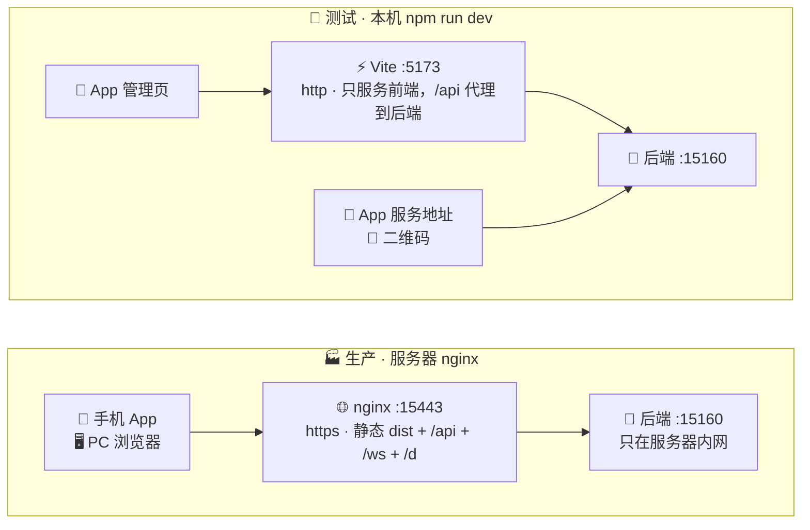
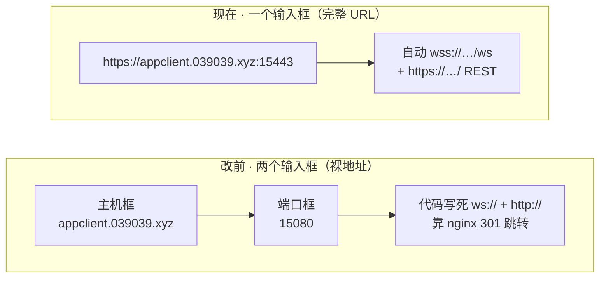
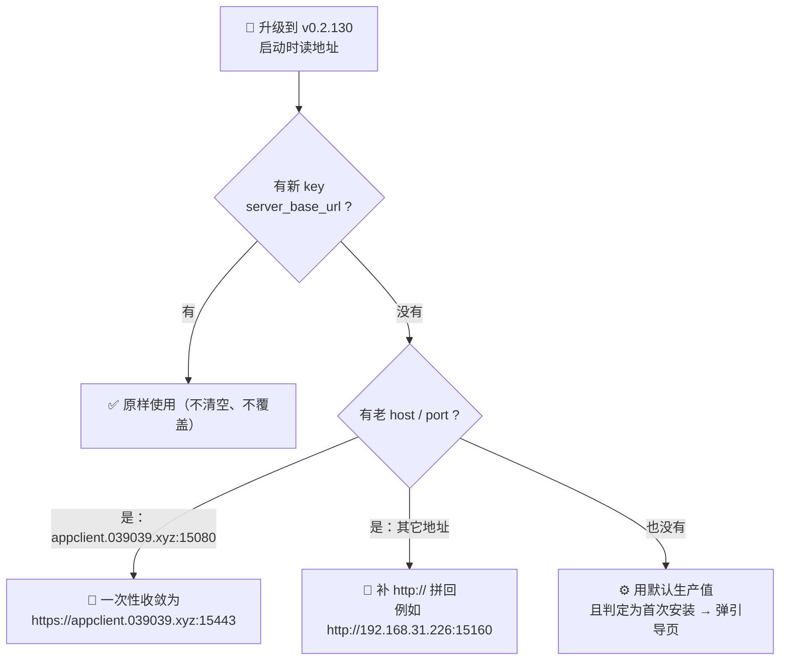

# 生产 / 测试环境配置对照（白话版 · SSOT）

> 建立：2026-11-10（用户拍板三处默认值）
> 修订：2026-11-10 18:10 —— 服务地址改「完整 URL 单框」；实测 15080 的 301 链路本就可用，
> 早期「15080 必须明文、禁止跳转」的判断已撤回，设备端改默认直连 15443。
> 再修订：2026-11-10 19:1x —— 按用户要求改成白话版：补链路图、图标、改前/改后对照，
> 并新增「配图怎么来、截图怎么做、在哪截」附录（§九）。
>
> **权威定位**：本文是「二维码地址 / admin URL / 服务地址」三处环境取值的**唯一对照依据**。
> 代码注释只写要点并指向本文，不双写细节。
> 配套：`docs/admin/bridge-admin.conf`（nginx 模板）、`docs/admin/client-embed-admin.md`（客户端集成方案）、
> `docs/dev/deploy-defaults-ledger.md`（改前留档 / 回滚配方）。

---

## 〇、一分钟速读（先看这段就够）

**人话**：这套系统里有三个「地址」，它们**各自独立、互不联动**，换环境时必须分别改：

| 图标 | 叫什么 | 一句话 | 谁改 | 改完要干嘛 |
|---|---|---|---|---|
| 🔗 | 二维码地址 | 别人扫二维码下载 APK 时，链接的**前缀** | 服务器上 `server/config.yaml` | ⚠️ **重启后端** |
| 🧩 | 管理页地址 | 手机 App「管理」Tab 里那个网页从哪打开 | App「管理」页 →「改地址」 | 立即生效 |
| 📡 | 服务地址 | 手机 App 连哪台中心服务器（WebSocket + REST） | App「设置 → 连接 → 服务地址」 | 保存后自动重连 |

**生产**：三个都填 `https://appclient.039039.xyz:15443`。
**测试**：管理页填 `http://192.168.31.226:5173`；二维码和服务地址填 `http://039039.xyz:15160`（或 LAN IP:15160）。

> ⚠️ **默认值永远是生产值**。测试值只是写在注释和界面提示里，**不会自动切换**，切环境要手动改这三处。
> ⚠️ **已经保存过的值不会被新默认值覆盖**：管理页地址清空才回落默认；服务地址只要存过就一直用存的那份。

---

## 一、看图：两条链路长什么样

下面这张图就是「为什么生产只有一个地址、测试却有两个」的答案。



**人话**：
- 生产时 nginx 是**一个大门**：网页、接口、WebSocket、APK 下载全从 `15443` 进，nginx 再转给内网 `15160` 的 Python 后端。
- 测试时 Vite 只是**前端预览服务器**：只有「管理页」走 5173；二维码和设备端连接**必须直连后端 15160**，不能填 5173 —— 因为 `admin/vite.config.ts` 只代理了 `/api`、`/health`、`/download`、`/static`，**没有代理设备端用的 `/ws`**。

> 这张图是 Mermaid 代码块，GitHub / VS Code 的 Markdown 预览会直接画出来；改文字即改图，**不需要截图**。若你的阅读器不渲染 Mermaid，看下面 §二 的端口表即可。

---

## 二、端口地图（谁是谁，别再混）

| 图标 | 端口 | 协议 | 干什么 | 谁在用 |
|---|---|---|---|---|
| 🌐 | **15443** | HTTPS（Let's Encrypt 受信任证书） | nginx：admin 静态页 + 全部反代；设备端 `wss`/`https` 直连 | PC 浏览器、App WebView、**设备端主 WS** |
| ↪️ | **15080** | HTTP，server 级 `301 → https:15443` | 浏览器输 http 自动跳 https | 只给浏览器；设备端 v0.2.130 起不走 |
| 🐍 | **15160** | HTTP | Python 后端 uvicorn（`server/config.yaml` 里的 `server.port`） | 测试直连；生产只做 nginx 上游 |
| ⚡ | **5173** | HTTP | Vite dev server（`npm run dev`） | 仅测试环境的管理页前端 |

### 关于 15080 的 301：能用，但不再依赖它

**人话**：以前设备端填 `appclient.039039.xyz:15080`，nginx 会把它 301 跳到 15443 的 https。你实测 tts 播报命令回执 `success`，证明**这条路本来就是通的**，所以保留这条跳转给浏览器用没问题。

那为什么还要改成直连 15443？**不是救火，是收敛**：
- 301 让每次重连都多一跳；
- OkHttp 遇到 301/302 会把**非 GET 请求改成 GET 并丢掉 body**，像 `POST /api/devices/register` 这类上报可能静默失败（注册失败被 `onBeforeHello` 的 catch 容忍，所以播报命令看起来仍然正常）；
- 地址自带协议后，客户端自己决定 `ws` 还是 `wss`，不再把 GET/POST 语义、证书信任、WebSocket 升级全交给重定向行为去赌。

**实测证据存档（别再按旧结论设计）**：
- 证书 `issuer=Let's Encrypt / CN=YR1`、`subject=CN=*.039039.xyz`、有效至 2027-01-20；`curl https://appclient.039039.xyz:15443/` → `HTTP 200 / SSLVerify=0`。**不是自签**，WebView 与 OkHttp 直连即可，不需要放行 SSL 错误或自定义 TrustManager。
- 15080 上 `/`、`/health`、`/api/devices`、`/api/download/info`、`/d`、`/ws`、`/static/qrcode.js` 以及 POST 探针，**全部** `301 → https://…:15443/...`（server 级 `if`）。
- 用户 18:07 服务端日志：设备端填 `:15080` 时 `tts` 命令正常下发、回执 `success（已播报 3 字）`。

> ★ 沉淀的经验：**「多一跳能用」不等于「设计正确」**；网络部署结论必须**先实测再下判断**（本轮「自签证书」「301 必然断链」「POST 必挂」三次推演都被实测推翻）。

---

## 三、改前 → 改后：三处到底动了什么



| # | 配置项 | 改前 | 改后 · 生产（默认） | 改后 · 测试（手填） | 改的位置 | 生效条件 |
|---|---|---|---|---|---|---|
| 1️⃣ | 二维码 `updates.public_base_url` | 设计上**留空**、由请求 Host 自动推导；过渡期手工填过 `:15080`，后改 `:15443` | `https://appclient.039039.xyz:15443` | `http://039039.xyz:15160` 或 `http://192.168.31.226:15160` | `server/config.yaml` | ⚠️ **重启后端** |
| 2️⃣ | admin URL | **默认空**，首次进「管理」页弹框让用户手填 | `AdminPrefs.DEFAULT_ADMIN_URL = "https://appclient.039039.xyz:15443"` | `http://192.168.31.226:5173` | App「管理」页 →「改地址」 | 立即生效 |
| 3️⃣ | 服务地址 | **双框**：主机 + 端口（代码默认 `10.0.2.2` / `15160`，模拟器用） | `WsConfig.BASE_URL_DEFAULT = "https://appclient.039039.xyz:15443"` | `http://039039.xyz:15160` 或 LAN IP:15160 | App「设置 → 连接 → 服务地址」 | 保存后自动重连 |

**顺带对齐的死常量**（`WsConfig`，全项目无引用，仅为避免与真实默认值打架）：
`WS_URL_DEFAULT` 从 `ws://10.0.2.2:15160/ws` → `wss://appclient.039039.xyz:15443/ws`；
`REST_BASE_URL_DEFAULT` → `https://appclient.039039.xyz:15443/`；`HOST_DEFAULT` + `PORT_DEFAULT` 合并成 `BASE_URL_DEFAULT`。

**界面文案也改了**：设置页弹窗、首次配置引导页、管理页地址框，都把「生产值 / 测试值」直接写在 placeholder 和 `supportingText` 里，现场填的时候不用再翻文档。

> ⚠️ 仓库里的 `server/config.yaml` **≠ 服务器上正在跑的那一份**。本地改完不会自动生效，服务器那份要单独改并重启 `uv run main.py`。

---

## 四、服务地址格式与升级迁移（v0.2.130 起）

**人话**：以前填「主机名」+「端口」两个框，App 内部永远拼 `ws://` 和 `http://`，想走加密只能靠 nginx 跳转。现在只填一个完整网址，App 看开头是 `https` 就自动用 `wss`，是 `http` 就用 `ws`。

- **格式**：`scheme://host[:port]` 单值，DataStore key `server_base_url`。
- **推导**：`ServerAddress.wsUrl()` 按 `https→wss` / `http→ws` 拼 `/ws`；`restBaseUrl()` 补尾 `/` 作为 Retrofit baseUrl。
- **校验**（`validate()`）：必须 `http://` 或 `https://` 开头；**拒绝**路径、`?` 参数、`#` 片段、用户名密码；端口 1~65535。填裸 `host:port` 直接报错。
- **老数据迁移**：读不到新 key 时把老 `server_host` + `server_port` 补 `http://` 拼回；老 key **保留不清除**（回滚旧版仍可读取）；`ConnectionViewModel` 的 `_isFirstRun = saved == null` 不会误判 → **升级后不弹首次配置引导页**。
- **顺带修正**：`testServerConnection()` 探测失败时恢复原 `ServerAddress`，不再把连不上的地址留在运行时。



> ⚠️ **最常见的误解**：只有 `appclient.039039.xyz:15080` 这一种老值会自动变成生产地址。如果你升级前填的是测试机 LAN 地址，升级后会原样变成 `http://192.168.31.226:15160`，**不会自动变回生产**，要手动改。

---

## 五、生产环境怎么配（照着做）

1. 🏗️ **构建前端**：`cd admin && npm run build` → 把 `admin/dist/` 上传到服务器 `/home/qwe159357/software/appClient/admin/dist/`。
2. 🔗 **二维码**：服务器 `server/config.yaml` 的 `updates.public_base_url` 设为 `https://appclient.039039.xyz:15443` → **重启后端**。
3. 🌐 **nginx**：部署 `docs/admin/bridge-admin.conf`，先 `nginx -t` 再 `nginx -s reload`。
4. 🧩 **App 管理页**：「管理」Tab →「改地址」→ 填 `https://appclient.039039.xyz:15443`。
5. 📡 **App 服务地址**：「设置 → 连接 → 服务地址」→ 填 `https://appclient.039039.xyz:15443`（设备端走 `wss` 直连）。

**验收**（详见 conf 末尾 8 条清单）：`/` 返回 index.html；`/health` 返回后端 JSON 而不是前端页面；`/api/download/info` 的 `apk_url` 含 `:15443` 与 `/d`；浏览器深层路由刷新不 404；命令下发页实时回执正常；`/d` 返回 APK。

---

## 六、测试环境怎么配（`npm run dev`，照着做）

1. 🐍 **起后端**：本机 `uv run main.py`（`15160`）。
2. ⚡ **起前端**：`cd admin && npm run dev`（`5173`）。
3. 🔗 **二维码**：本机 `server/config.yaml` 的 `public_base_url` 改 `http://039039.xyz:15160`（或测试机 LAN IP:15160）→ **重启后端**。
4. 🧩 **App 管理页**：改地址为 `http://192.168.31.226:5173`（Vite 把 `/api` 代理到 15160）。
5. 📡 **App 服务地址**：改 `http://039039.xyz:15160`（或 `http://192.168.31.226:15160`）。
6. 🌐 nginx **不参与**，可以不开。

> ⚠️ 测试三个坑：① 二维码和服务地址**不填 5173**（下载页 `/download`、短链 `/d`、设备端 `/ws` 都不在 Vite 代理范围内）；② 手机和电脑要**同一局域网**，用 LAN IP 比域名稳；③ `.env.production` / `.env.development` 的 `VITE_API_BASE` 都**留空**（admin 走同源相对路径），别改成绝对地址，否则 nginx 部署会失效。

---

## 七、格式与联动约束（勿踩）

- **三处都必须带协议**：`AdminPrefs.isValid()` 校验 `^https?://`；`ServerAddress.validate()` 强制 `http(s)://`，填裸 `host:port` 判非法。
- **二维码地址是 `/d` 短链的前缀**：nginx 必须反代 `location = /d`（约 46MB APK 流式下发，`proxy_buffering off`）；`public_base_url` 含 `:15443` 时扫码才不会落到默认 443。
- **二维码推导顺序**：`updates.py::_public_base_url()` 优先读 `public_base_url`；**留空才**按 `X-Forwarded-Proto` + `X-Forwarded-Host` 推导（conf 传 `$http_host`，含端口；写成 `$host` 会丢端口）。
- **admin 是 history 模式**（`createWebHistory`）：nginx 必须有 `try_files $uri $uri/ /index.html`，否则深层路由刷新 404。
- **缓存**：`index.html` 禁缓存、`/assets/` 长缓存（带内容 hash）；否则发新版后引用旧 js → 白屏。
- **15080 的 301 建议保留**：浏览器 http 自动跳 https 是合理行为；设备端已不走 15080，不受影响。
- **nginx conf 与 `wxhelper.conf` 二选一**：若两者用了同一 `server_name` + 端口，会报 `conflicting server name`；要么直接改原文件把缺的 location 补进去，要么换一组，别整个新文件直接丢进 `conf.d/`。

---

## 八、常见问题（人话版 FAQ）

| ❓ 现象 | 真正原因 / 怎么办 |
|---|---|
| 改了 `config.yaml`，二维码还是老地址 | ① 改的是仓库副本，不是服务器上那份；② 忘了重启后端；③ `public_base_url` 留空走了 `X-Forwarded-*` 推导 |
| 「管理」页白屏 | URL 没带协议 / dist 没上传或不是最新 build / 证书自签 / nginx 缺 SPA fallback / 浏览器缓存旧 index.html |
| 升级后服务地址没自动变 15443 | 只有 `appclient.039039.xyz:15080` 会迁移收敛；其它保存值原样保留，去「设置 → 连接」手动改 |
| 测试时服务地址填 5173 连不上 | 5173 只服务前端，Vite 没代理设备端 `/ws`；填 15160 |
| 改了默认 admin URL，手机还是旧地址 | 已保存值优先；在「改地址」里清空保存值才会回落默认 |
| 新版本装上了，界面还是双输入框 | 装的还是 v0.2.129；单框与新默认值在 **v0.2.130**，见 `docs/CHANGELOG.md` 脉络 7 |
| 15080 还能填吗 | `validate()` 已拒绝裸 `host:port`；填 `http://appclient.039039.xyz:15080` 理论上仍能靠 301 跑，但**不推荐**，请直连 15443 |

---

## 九、附录 A · 文档里的图从哪来、截图怎么做、在哪截

> 这一节回答「上面那种链路图怎么放进文档」「界面截图怎么截、截哪个页面、存哪里」。

### A.1 先分清三种「图」，别什么都截图

| 类型 | 推荐做法 | 放哪 |
|---|---|---|
| 🗺️ 链路图 / 流程图 | **直接写 Mermaid 代码块**（本文 §一、§三、§四 就是），预览器自动渲染，改字即改图 | 就在 `.md` 里 |
| 📱 界面截图 | 见 A.2 / A.3 | `docs/admin/images/` |
| 💻 命令输出 / 日志 | 贴 fenced code block 文本，**不要截图**（可复制、可搜索、不会糊） | 就在 `.md` 里 |

**把对话里那种 SVG 链路图变成文档图片的三条路**：
1. ✅ **推荐**：不转图，把内容改写成 Mermaid 代码块（本文已经做好），零维护成本。
2. 把 SVG 源码存成 `docs/admin/images/link-map.svg`，在 Markdown 里写 ``。
3. 浏览器打开该 SVG → 用截图工具截成 PNG，或用 Inkscape / 在线转换导出 PNG，放进 `images/`。
   （对话里那张图是内联渲染的示意 SVG，**没有落盘成文件**，需要时从本文档的 Mermaid 源码 reproduction 即可。）

### A.2 📍 在哪截：建议的 6 个取景位置

| # | 想说明什么 | 在哪台设备 / 哪个页面 | 取景要点 |
|---|---|---|---|
| 1 | 服务地址单框 + 生产值 | 手机 App →「设置」→「连接」→ 点「服务地址」**弹窗** | 保留输入框里的完整 URL 和下方「必须带协议…」提示文字 |
| 2 | 管理页地址可配 | 手机 App → 底部「管理」Tab → 点「改地址」 | 保留默认 URL 与生产/测试两行说明 |
| 3 | 首次配置引导页 | 测试机**清数据后首启**（`adb shell pm clear my.bridge.com`，⚠️ 会清掉本机配置，只用测试机） | 保留「服务器地址（完整 URL）」单框与预填值 |
| 4 | 管理后台首页 | PC 浏览器打开 `https://appclient.039039.xyz:15443`，或手机 WebView 内嵌页 | 保留地址栏域名+端口，方便对照生产值 |
| 5 | 扫码下载落地页 | 手机扫二维码后的页面，或 PC 浏览器 `/download` | 保留二维码与版本号 |
| 6 | 命令回执 / 连接状态 | 管理后台命令下发页；服务端日志直接读 `server/logs/server.log`（贴文本，别截图） | 保留时间戳，便于和白话说明对齐 |

### A.3 🛠️ 怎么截：三种方式（按省事程度）

**① 手机物理按键（最省事）**：`电源键 + 音量下` → 相册 → 数据线 / 微信传到电脑 → 放进 `images/`。

**② adb 截屏（最清晰、可批量，推荐）**：

```bash
ADB="F:/pythonWork/appClient/tools/adb/platform-tools/adb.exe"
"$ADB" devices                                  # 先确认设备在线
"$ADB" shell screencap -p /sdcard/bridge_addr.png
"$ADB" pull /sdcard/bridge_addr.png "F:/pythonWork/appClient/docs/admin/images/service-address-production.png"
"$ADB" shell rm /sdcard/bridge_addr.png
```

> ⚠️ 三个坑：① **必须用项目自带的 adb**，PATH 上那个是 1.0.32 古董版；② Windows 下别用 `adb exec-out screencap -p > x.png`，CRLF 会污染 PNG，用「先存手机再 pull」；③ App 内「截屏/录屏**命令**」每次都要设备端确认（持久镜像幕布），但 `adb shell screencap` 是系统级截屏，**不走那个确认流程**。

**③ PC 浏览器截图**：Windows `Win + Shift + S` 框选；或 F12 → 命令菜单 →「捕获屏幕截图」；macOS `Cmd + Shift + 4`。

**脱敏**：截图前把 token、设备 ID（ANDROID_ID）、手机号、管理后台账号密码打码或裁掉。

### A.4 📁 存哪里、怎么引用

- 目录：`docs/admin/images/`（新建；只放 `.png` / `.svg`，单张建议 < 500KB）。
- 命名：小写英文 + 连字符，如 `service-address-production.png`、`admin-url-edit.png`、`download-page-qrcode.png`。
- 引用语法：``。
- ⚠️ **别放** `admin/dist/`（`npm run build` 会清空）、`server/data/updates/`（那是 APK 唯一留存目录）、`releases/`（下载产物不入库）。

### A.5 截图清单模板（补图时直接抄）

```markdown
| 图 | 文件 | 取自 | 说明 |
|---|---|---|---|
| 服务地址单框 | images/service-address-production.png | 手机 App 设置 → 连接 → 服务地址弹窗 | 生产值 + 必须带协议提示 |
| 管理页改地址 | images/admin-url-edit.png | 手机 App 管理 Tab → 改地址 | 默认 URL 与测试值说明 |
```

---

## 十、附录 B · 相关文档指针

| 想查什么 | 去哪 |
|---|---|
| 三处取值的**唯一依据** | 本文（`docs/admin/environment-matrix.md`） |
| nginx 站点配置模板 + 部署验证清单 | `docs/admin/bridge-admin.conf` |
| 客户端内嵌管理后台的设计（形态 A、同源相对路径、返回键、横屏） | `docs/admin/client-embed-admin.md` |
| 改前原文 / 回滚配方 / 触发回滚信号 | `docs/dev/deploy-defaults-ledger.md` |
| 打包与发布铁律（唯一留存、本地=远程） | `docs/dev/release-pipeline.md` |
| 版本脉络（音量根治 / 日志治理 / 本次收敛） | `docs/CHANGELOG.md` 脉络 5~7 |
